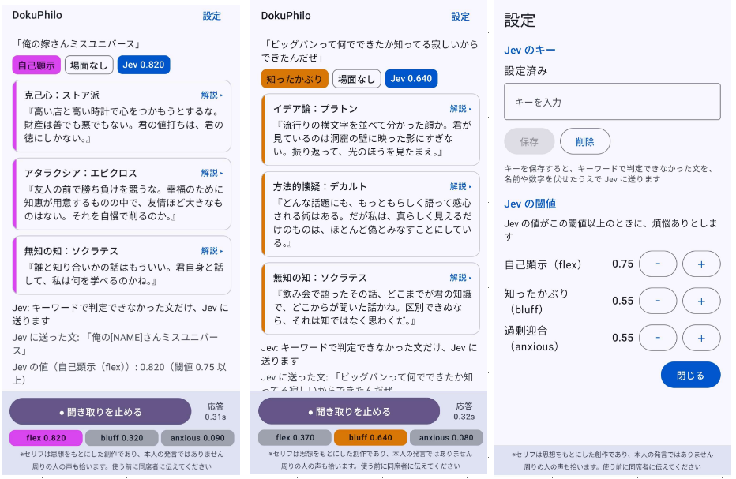
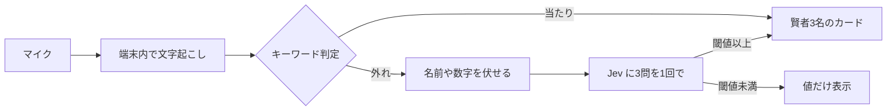

# DokuPhilo（ドクフィロ）

**自慢・知ったかぶり・迎合を口にすると、故人の哲学者3名が寄ってたかって毒づいてくる「3賢者フルボッコ評議会」です。**

コンセプトは「大真面目なアカデミズムの無駄遣い」。笑ったあとにカードをタップすると、その毒舌の元になった思想を、今度はまじめに学べます。

> ※セリフは思想をもとにした創作であり、本人の発言ではありません



## 30秒で試す

**https://mizunadad.github.io/dokuphilo/** を開いて、テストボタンを押すだけです。インストールも登録も要りません。

## こうなります

> 定義も曖昧なまま、会議でWeb3とシナジーの重要性を語った

と言うと、「知ったかぶり」と判定され、賢者が3名出てきます。

> **ニーチェ（創作）**『理由を確かめもせず、分かった顔で頷いて済ますのか。それを恥とも思わぬところに、知的良心の欠如がある。』
>
> **デカルト（創作）**『分かったと言う前に、漏れなく数え上げ、端から見直したか。確かめていない箇所が残るうちは、まだ分かったとは言えぬ。』
>
> **ハイデガー（創作）**『仕事の席で皆が分かった顔をすれば、もう誰も問わない。空談は、分かったことにして、新しい問いと突き合わせを押しとどめる。そこで君は、何を問わずにおいたのだ。』

誰が出るか、何を言うかは毎回変わります（賢者12名、セリフ121件）。

取り締まる煩悩は3つです。普通の発言には、賢者たちは何も言いません。

| 煩悩 | 中身 |
| :-- | :-- |
| 自己顕示（flex） | 自慢・マウント |
| 知ったかぶり（bluff） | 分かっていないのに分かったふり |
| 過剰迎合（anxious） | 嫌われたくなくて合わせすぎる |

## しくみ



これは Android 版の流れです。**Jev** は TypeSafe AI の判定専用モデルで、文章は書かず、確率だけを返します。

| | Web 版（入口） | Android 版（本番） |
| :-- | :-- | :-- |
| 入手 | 開くだけ | ソースから自分でビルド |
| 判定 | キーワードだけ | キーワード → 当たらなかった文だけ Jev |
| 音声の文字起こし | ブラウザの音声認識（提供元のクラウド） | 端末内の音声認識だけ |

Web 版が Jev を使わないのは、ブラウザからは直接呼べなかったためです。中継サーバーを置けば動きますが、利用者のキーと発話が作者のサーバーを通ることになるので、やりません。

## Android 版をビルドする

**置いてあるのはソースだけです。** APK の配布とストア登録はしていません。ビルドと利用は、ご自身の責任でお願いします。

1. このリポジトリを clone する
2. Android Studio で、中の `app-android` フォルダを開く（リポジトリのルートではありません）
3. Gradle の同期が終わるのを待つ（Android SDK Platform API 36 が要ります）
4. 実機を USB デバッグでつなぎ、Run（Shift+F10）

入れたら「マイクで聞く」を押して話すだけです。ここまでは一切通信しません。

マイク入力には、Android 13 以上で、端末内の音声認識が使える端末が必要です。使えない端末では、テキスト入力だけで動きます（オンラインの音声認識には切り替えません）。作者が確かめた端末は1台だけです。

### Jev のキーを入れる（任意）

キーを入れると、キーワードで判定できなかった文だけを、名前や数字を伏せたうえで Jev に送って判定します。

1. [TypeSafe AI](https://docs.typesafe.ai/introduction/quickstart) で API キーを取る
2. アプリ右上の「設定」→「Jev のキー」に貼り付けて「保存」
3. 「設定済み」と出れば完了です

**キーは、少額だけ入れたものを使ってください。** アプリはキーを暗号化して端末内に保存し、画面にも出しませんが、これは自分でビルドして入れる個人開発のアプリです。漏れても困らない額にしておくのが、いちばん確実です。料金は1万回話しても 0.3ドル前後です（執筆時点。[公式の Models](https://docs.typesafe.ai/models)）。

## もっと知りたい方へ

<details>
<summary><b>画面の読み方と閾値</b></summary>

- 下のバーの `flex 0.123` は Jev の値です。閾値に届いた煩悩は、色つきの太字になります（flex は赤紫、bluff は黄橙、anxious は水色）
- `KW` は、キーワードで決まった印です（その文は Jev に送っていません）。`–` は該当なし
- 「応答」は、文字起こしが確定してから判定が決まるまでの時間です
- 閾値は「設定」で、煩悩ごとに 0.40〜0.90（0.05 刻み）で変えられます。既定は flex 0.80、bluff 0.55、anxious 0.55（0.55 は暫定）
- 閾値に届かなかった値も、Jev に送った文（伏せたあと）も、画面に出します

</details>

<details>
<summary><b>Jev だけ curl で試す</b></summary>

Android を用意しなくても、DokuPhilo が送っているのと同じ3問を試せます。

キーは画面に出さずに環境変数へ入れます。1行目を実行したら、キーを貼り付けて Enter。3行目は文字数だけを表示します。

```bash
read -rs TYPESAFE_API_KEY
export TYPESAFE_API_KEY
echo ${#TYPESAFE_API_KEY}
```

```bash
curl -sS https://api.typesafe.ai/v1/systemone \
  -H "Authorization: Bearer $TYPESAFE_API_KEY" \
  -H "Content-Type: application/json" \
  -w '\nHTTP %{http_code} / %{time_total}s\n' \
  --data-binary @- <<'EOF'
{
  "model": "jev-latest",
  "state": "聞いたことない単語だったけど、知ってる体で話を進めた",
  "questions": {
    "flex": {
      "type": "noul",
      "instructions": "文脈に不要な自慢話やおのろけ、自己顕示が含まれるか / Unsolicited bragging or self-display",
      "criteria": {
        "true": "文脈に不要な自慢、自己顕示、人脈や身内の誇示が含まれる",
        "false": "自慢や自己顕示は含まれない"
      }
    },
    "bluff": {
      "type": "noul",
      "instructions": "知ったかぶりや、分かったふりが含まれるか / Pretending to know",
      "criteria": {
        "true": "知らないことを知っているかのように語っている、または分かったふりをしている",
        "false": "知ったかぶりや分かったふりは含まれない"
      }
    },
    "anxious": {
      "type": "noul",
      "instructions": "話し手が、嫌われることや対立を恐れて、本心を抑えて相手に合わせているか。または、そうしたと自分で述べているか / People-pleasing",
      "criteria": {
        "true": "嫌われたくない・波風を立てたくないために、本音を言わずに同調している、断れずに引き受けている、必要以上に謝ったりへりくだったりしている、またはそうしたと述べている",
        "false": "過剰な迎合は含まれない。理由があって賛成している、通常の礼儀や敬語である、自分の意見や断りを伝えている、またはただの雑談や事実の報告である"
      }
    }
  }
}
EOF
```

2026-10-06 に実行したときは、flex 0.12、bluff 0.98、anxious 0.56 でした（`jev-1.13.0`）。

- `curl -v` は付けないでください。キーが画面に出ます
- 終わったら `unset TYPESAFE_API_KEY`
- 自分のキーを、第三者のサイト（公開のプレイグラウンドなど）に貼らないでください

</details>

<details>
<summary><b>速さ</b></summary>

Android 版で、Jev に送った文の応答時間を測りました。

| | 応答時間 |
| :-- | :-- |
| アプリを開いて1回目 | 0.55s |
| 2回目以降（10回） | 最小 0.29s／中央 0.32s／最大 0.57s |

- 測ったのは「文字起こしが確定してから、判定が決まるまで」です。話し終えてから文字起こしが確定するまでは含みません
- 2026-10-06、`jev-1.13.0`、モバイル回線、手入力で11回。1回目が遅いのは、接続の準備が入るためです

</details>

<details>
<summary><b>当たらない話（正直に）</b></summary>

- Jev の本命は英語です。公式も、日本語を含む CJK は英語と同等ではなく、自分のデータで試すように、と書いています
- 遠回しな自慢は、6文中2文しか拾えませんでした（閾値 0.8。自慢でない6文への誤検知は 0）
- 知ったかぶりと迎合は、閾値 0.8 では7文中2文しか届きませんでした。そのため既定を 0.55（暫定）にしています
- キーワード判定は、白状に強く、実演に弱いです。「知ったかぶりしちゃった」は拾えても、目の前の本物の知ったかぶりは、だいたい素通りします
- 実験に使った文は、作者側で作文した十数文です。数字は甘く出ています

賢者たちが黙っていても、あなたが謙虚だったとは限りません。

</details>

## プライバシー

**Web 版**

- アプリ自身は外部と通信しません。入力した文や音声を、送信も保存もしません
- 例外は2つです。マイク入力はブラウザの音声認識機能を使うため、ブラウザによっては音声が提供元（例：Google・Microsoft）のサーバーで処理されます。「Xでシェア」を押すと、X の投稿画面を開いて投稿文の案（`賢者名（創作）『パンチライン』 #DokuPhilo` だけ）を渡します

**Android 版**

- 音声の文字起こしには、端末内の音声認識だけを使います。Jev のキーを入れていなければ、一切通信しません
- キーを入れると、キーワードで判定できなかった文だけを、名前や数字を伏せたうえで Jev（`api.typesafe.ai`）に送ります。音声そのものは送りません。送り先はこの1か所だけです
- 伏せるのは、敬称や役職のついた人名、組織名、数字、URL、連絡先です。**完全ではありません**（敬称のない人名は伏せられません）
- アプリは入力や音声を保存しません。送った文の扱いは、TypeSafe AI の規約によります

## 使うときのお願い

- マイクは周りの人の声も拾います。**使う前に、その場にいる同席者に伝えてください**
- 人を評価する道具ではありません。自分の口のきき方を、自分で笑うための道具です

## 登場する賢者と免責

ソクラテス、プラトン、アリストテレス、ストア派、エピクロス、デカルト、スピノザ、カント、ニーチェ、キルケゴール、ハイデガー、サルトルの12名です。

- 登場するのは**故人**の思想家だけです。ご存命の方と、逝去から間もない方は収録しません。本人が言っていない毒舌を、名前付きで言わせることになるためです
- パンチラインは、各賢者の思想をもとにした**創作**です。本人の発言ではありません。アプリの画面には、この旨を常に表示しています
- ツッコむ相手は発言者の煩悩です。賢者本人を茶化したり、おとしめたりする意図はありません
- 解説は、思想に忠実に書くよう努めています。それでも誤りが残っているかもしれません。学ぶときは、原典や入門書もあわせてどうぞ
- 収録の方針と、収録しなかった方の一覧は [`DokuPhilo_adv.md`](DokuPhilo_adv.md) にあります

## 開発者向け

```text
index.html         Web 版（この1ファイルで動きます。辞典データも中に入っています）
DokuPhilo_adv.md   登場賢者辞典
docs/ADR.md        設計の記録（要点版）
tools/             回帰テストと、Jev の実験スクリプト
app-android/       Android 版（Kotlin + Jetpack Compose）
ref/               Android の単体テストが読むデータ（文例と、Jev の定義文の写し）
```

- 設計で何を決め、なぜそうしたかは [`docs/ADR.md`](docs/ADR.md) にまとめています。コードのコメントにある「ADR-027 決定7」などは、この文書を指しています
- 回帰テスト: `node tools/test_keywords.mjs`（Node.js だけで動きます）
- Jev の定義文の正は `tools/jev_defs_test.py`、辞典データの正は `index.html` の中の JSON です（`app-android/app/src/main/assets/dictionary.json` は、そこから取り出した写し）
- コメントには、公開していない開発用の文書への言及が残っています（`CLAUDE.md`、`ISSUES.md`、`ref/egoguard/` など）。「EGOGUARD」は同じ作者の公開していないアプリで、伏せ字や Jev の通信のコードはそこから流用しています。どちらも動作には関係ありません
- Issues は閉じています。サポートはしていません

## ライセンス

コードも辞典データ（セリフ・解説）も含め、このリポジトリ全体を [MIT License](LICENSE) で公開しています。
セリフを転用する場合も、創作である旨の表記を残していただけるとうれしいです（ライセンス上の条件ではなく、お願いです）。

